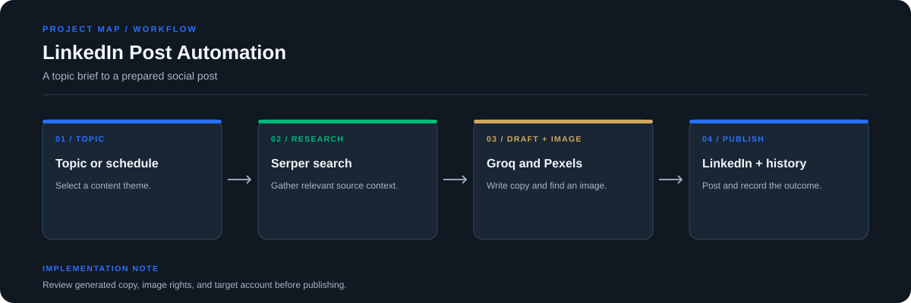

# LinkedIn Post Automation

A Streamlit workflow that helps prepare LinkedIn posts from topic ideas. The automation pipeline combines web research, draft generation, image selection, and a local post history.

**Stack:** Python, Streamlit, Groq, Serper, Pexels, LinkedIn integration, SQLite/JSON history



## Workflow

1. Select a topic from the configured topic list.
2. Search for context using Serper.
3. Draft the post with Groq and select an image through Pexels.
4. Review and publish through the configured LinkedIn integration.
5. Record history and logs so previous runs can be inspected.

## Code map

- `app.py`: Streamlit interface and post history
- `core/automation.py`: automation pipeline
- `core/`: generation and integration logic
- `config/`: topic and path configuration
- `data/`: local history data
- `requirements.txt`: Python dependencies

## Run locally

```bash
git clone https://github.com/chyk2468/Linkedin-Post-Automation.git
cd Linkedin-Post-Automation
python -m venv .venv
```

Activate the environment and install dependencies:

```bash
pip install -r requirements.txt
streamlit run app.py
```

Configure credentials for the integrations in the configuration format expected by this project. Keep tokens outside version control.

## Publish responsibly

Review the final copy and source claims, confirm the selected image is permitted for use, and verify the destination account before publishing. Treat generated content as a draft, not as independently verified reporting.
