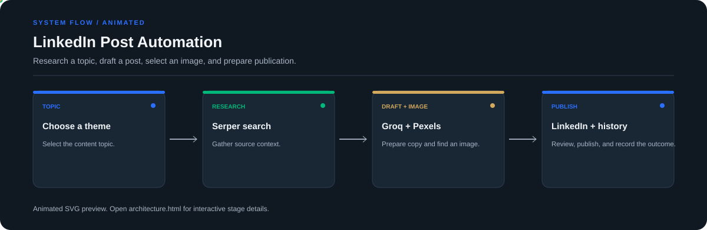

# LinkedIn Post Automation

**Research a topic, draft a post, select an image, and prepare publication.**

[](https://github.com/chyk2468/Linkedin-Post-Automation)

## 1. Project Title & Tagline

Research a topic, draft a post, select an image, and prepare publication.

## 2. Problem Statement

Preparing a social post involves research, writing, finding a suitable image, and tracking what was published. This project brings those steps into a Streamlit workflow.

## 3. Project Preview

Add a real screenshot or short GIF of the current interface, with sensitive tokens and personal data removed.

[Open interactive architecture](architecture.html)

## 4. Overview

The workflow connects input collection, processing, and a reviewable result. The implementation and available integrations depend on the configured environment.

## 5. Key Features

- Choose a topic from the configured list.
- Gather source context with web search.
- Generate a post draft and select an image.
- Publish through the configured LinkedIn integration and record history.

## 6. Architecture / Workflow



Open the [interactive architecture explorer](architecture.html) to select a stage and inspect its role.

## 7. Tech Stack

Python, Streamlit, Groq, Serper, Pexels, LinkedIn integration, local history storage

## 8. Installation & Setup

```bash
git clone https://github.com/chyk2468/Linkedin-Post-Automation.git
cd Linkedin-Post-Automation
python -m venv .venv
pip install -r requirements.txt
```

## 9. Usage

Configure the credentials in the format expected by the project, start `streamlit run app.py`, choose a topic, inspect the generated copy and image, and confirm the destination account before publishing.

## 10. Project Structure

- `app.py`: Streamlit interface and history
- `core/automation.py`: automation pipeline
- `core/`: generation and integration logic
- `config/`: topic and path settings
- `data/`: local history data

## 11. Results & Demo

Add a demo GIF showing topic selection, draft generation, image selection, and the publication-history entry. Include the actual integrations enabled in the current setup.

## 12. Future Enhancements

- Add approval and scheduling queues.
- Improve source attribution and claim checks.
- Add image-licence checks and post previews.
- Improve error handling and run logs.

## 13. License

Check the repository and integration terms. Keep all API keys and account tokens out of version control.
